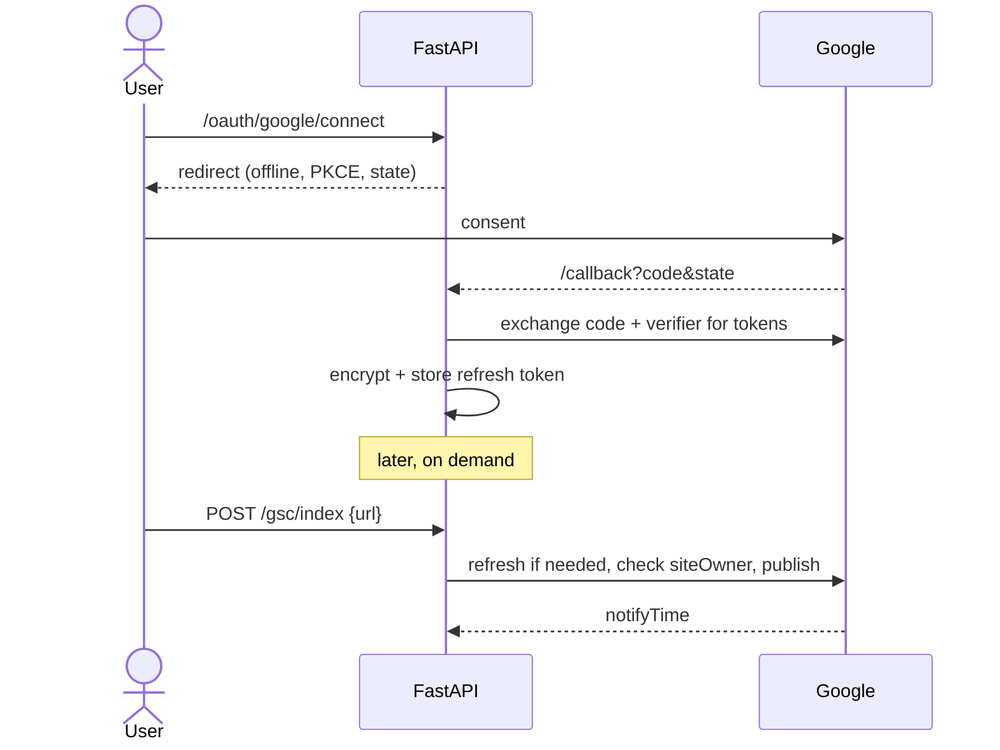

# Google Search Console OAuth utility (FastAPI)

A small FastAPI service that connects a user's Google account, keeps the grant healthy, and **requests indexing of a page on the user's behalf, on demand**. It covers the full token lifecycle: consent with PKCE, encrypted storage, refresh, revocation, and what happens when the user's Google account changes underneath us (password change, revoked access, hijacked account).

* **Written answer (the walkthrough):** [docs/WRITTEN_ANSWER.md](docs/WRITTEN_ANSWER.md)
* **Diagrams:** [docs/ARCHITECTURE.md](docs/ARCHITECTURE.md)



## Endpoints

| Method | Path | What it does |
|---|---|---|
| GET | `/oauth/google/connect` | Redirect to Google consent (state + PKCE, offline access) |
| GET | `/oauth/google/callback` | Validate state, exchange code, store encrypted tokens |
| GET | `/connections` | The user's Google connections and their health |
| POST | `/connections/{id}/refresh` | Force a refresh (debug / health check) |
| DELETE | `/connections/{id}` | Revoke at Google, then wipe locally |
| GET | `/gsc/sites` | Search Console properties with permission level |
| POST | `/gsc/index` | **Request indexing**: `{"url": "...", "type": "URL_UPDATED" \| "URL_DELETED"}` |
| GET | `/gsc/index/status?url=` | Indexing API metadata for a URL |
| POST | `/gsc/inspect` | URL Inspection API (Google's view of the page) |
| GET | `/gsc/index/history` | Audit log of indexing requests |
| POST | `/risc/events` | Cross-Account Protection receiver (signed security events from Google) |
| GET | `/dev/login?user_id=` | Stand-in for the host product's login (dev only) |

Errors are JSON with a stable `error` code. The one callers must handle is `409 google_reauth_required`, which carries a `reauth_url`.

## Run it

```bash
python -m venv .venv && source .venv/bin/activate   # Windows: .venv\Scripts\activate
pip install -r requirements.txt
cp .env.example .env    # fill in client id/secret, generate keys (command in the file)
uvicorn app.main:app --reload
```

1. In Google Cloud Console enable **Google Search Console API** and **Web Search Indexing API**, create a *Web application* OAuth client with redirect URI `http://localhost:8000/oauth/google/callback`, and add yourself as a test user.
2. Open `http://localhost:8000/dev/login?user_id=alice`, then `http://localhost:8000/oauth/google/connect`.
3. Use `http://localhost:8000/docs` to call `GET /gsc/sites` and `POST /gsc/index` for a URL on a property you **own** (verified owner, not just full user).

## Tests

```bash
pytest
```

43 tests, Google fully mocked with [respx](https://lundberg.github.io/respx/). They cover the PKCE redirect, state replay and cross-user state, partial consent, encrypted storage, transparent and 401-triggered refresh, `invalid_grant` vs transient failures, ownership checks, multi-account owner selection, quota, revocation (including Google being down), RISC events and key rotation.

## Layout

```
app/
  main.py            FastAPI app, middleware, error handlers
  config.py          settings from env
  google_oauth.py    raw Google OAuth endpoints: auth URL, code exchange, refresh, revoke
  token_service.py   the lifecycle: state/PKCE, store, refresh (single flight), invalidate, revoke
  gsc_client.py      Search Console + Indexing calls, property matching, 401 retry
  risc.py            Cross-Account Protection: verify SETs, react per event type
  crypto.py          AES-256-GCM key ring with row-bound AAD
  models.py          oauth_states, google_connections, index_requests, security_events
  routers/           HTTP layer
tests/               respx-mocked end-to-end tests
docs/                written answer + diagrams
```

## Design choices worth calling out

* **Raw HTTP instead of `google-auth-oauthlib`**, so every step of the flow is visible and testable.
* **Least-privilege scopes**: `webmasters.readonly` + `indexing` + `openid email`. Nothing writes to Search Console.
* **Two failure classes only**: transient (retry, keep the grant) and terminal (`invalid_grant`: wipe, `needs_reauth`). A Google outage never logs users out.
* **Ownership checked before publishing**: the Indexing API only accepts verified owners, so we say that clearly instead of passing on Google's generic 403.
* **Indexing API scope caveat**: Google documents it for `JobPosting` and livestream `BroadcastEvent` pages; the Search Console "Request indexing" button has no public API. See section 4 of the written answer.
