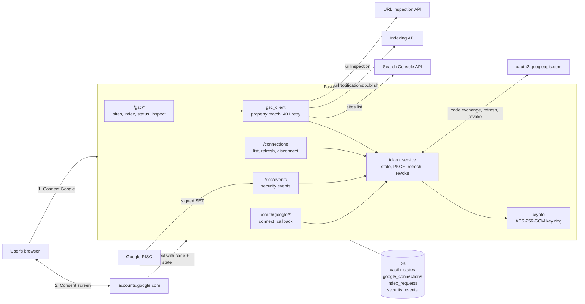
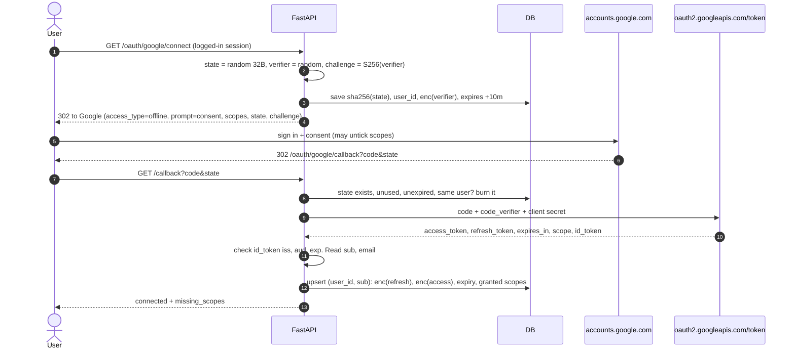
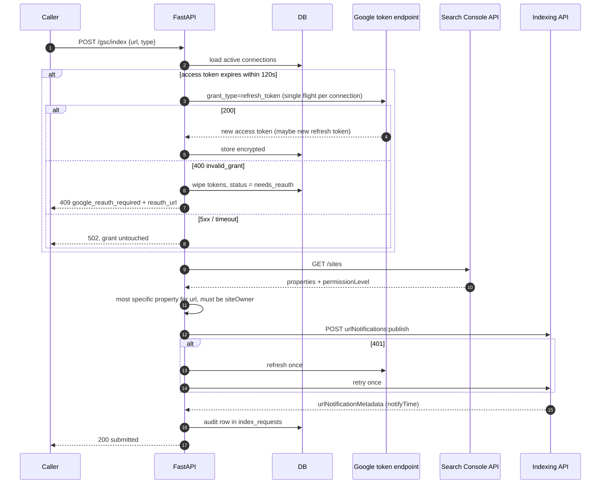
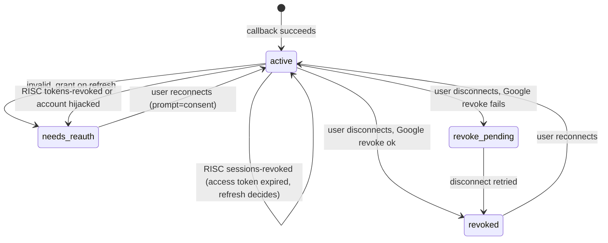
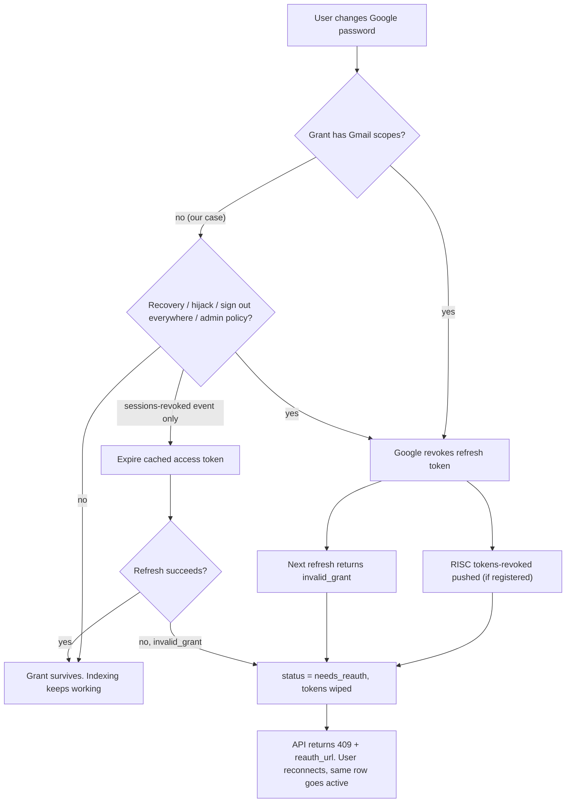

# Architecture and flow diagrams

## Components

## Connect (authorization code + PKCE)

## Request indexing, with transparent refresh

## Connection state machine

## Password change decision tree

